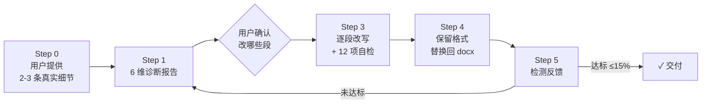

<div align="center">

# AIGC 文气复魂师 · aigc-deslop

**把被 AI 抹平的"人之痕迹"，重新还回字里行间**

[](LICENSE)
[](https://github.com/huanghfzhufeng/aigc-deslop/stargazers)
[](https://github.com/huanghfzhufeng/aigc-deslop/issues)
[](https://github.com/huanghfzhufeng/aigc-deslop/commits/master)
[](SKILL.md)

[**🚀 在线试用**](https://socialistic.ai/zh/skill/aigc-deslop-333114?utm_source=github&utm_medium=readme&utm_campaign=20260521-ai-text-humanizer-skills&utm_content=hero) ·
[**📖 SKILL 全文**](SKILL.md) ·
[**📊 案例研究**](data/case_study.md) ·
[**🛠 工作流**](examples/workflow.md)

[](https://socialistic.ai/zh/skill/aigc-deslop-333114?utm_source=github&utm_medium=readme&utm_campaign=20260521-ai-text-humanizer-skills&utm_content=badge)

</div>

---

## 这是什么

一套用于**中文论文降 AIGC 率**的方法论 + 工具集。基于真实毕业论文的 9 轮 PaperPure 实测迭代，把检测率从 **55% 降到 11%**，稳过 15% 红线。

为 Claude Code 设计的 Skill，也可以单独用其中的 Python 脚本。

> **English**: A Chinese-language methodology for reducing AI-detection in Chinese academic papers (知网 v2.13, PaperPure, 维普). Includes a Claude Code Skill (`SKILL.md`) and a Python script that rewrites paragraphs while preserving Word document formatting byte-for-byte. **Verified to reduce PaperPure detection from 55% → 11%** on a full thesis through 9 iterations.

---

## 9 轮实测

```
v0  原始 AI 写的论文            ████████████████████████████  55.0%
v1  市面工具同义词替换           ████████████████████          40.5%
v2  错误模仿"半口语化"           █████████████████████████     49.6%   ↑ 反弹
v3  本科生风格（仅 3 段）        █████████████                 27.0%   策略验证
v9  本科生风格 + 格式保留替换    █████                         11.0%   ✓ 达标
```

**降了 44 个百分点。完整迭代过程见 [`data/case_study.md`](data/case_study.md)。**

---

## 60 秒试用

不想 clone？点 [**Socialistic 在线 demo**](https://socialistic.ai/zh/skill/aigc-deslop-333114?utm_source=github&utm_medium=readme&utm_campaign=20260521-ai-text-humanizer-skills&utm_content=quickstart)，粘贴一段直接跑（平台承担 API 成本，不用自己的 key）。

想本地跑：

```bash
git clone https://github.com/huanghfzhufeng/aigc-deslop.git
cd aigc-deslop
pip install -r requirements.txt

# 已经有改写后的 markdown，直接塞回原 docx
python3 scripts/replace_docx.py 原.docx 改写后.md 输出.docx
```

作为 Claude Code Skill 使用（完整工作流）：

```bash
cp -r aigc-deslop ~/.claude/skills/
# 然后在 Claude Code 里说"我的论文 AI 率太高，帮我降一下"
# Skill 会自动按 SKILL.md 的工作流走
```

---

## 为什么市面上"用 AI 改 AI"经常失败

PaperPure 这类检测器训练时见过大量 LLM 输出（GPT / Claude / DeepSeek / Kimi）。LLM 越想"模仿人写"，反而越像 LLM 自己。

本项目的核心洞察：

**真实本科生写作 ≠ LLM 想象的"人写"**

| LLM 默认伪装"人写"（高检出） | 真实本科生写法（低检出） |
|----------|------------|
| 破折号、分号、顿号都用 | 基本只有逗号和句号 |
| "故意"短长穿插（仍规整） | 一逗到底，长句套定语 |
| 自动换近义词 | 同一个词反复用 |
| 一句承载多个论点 | 一句一意，常重复 |
| 偶尔用模糊语 | "比较""差不多""基本上"满天飞 |
| "其实""刚好""恰好" | "也就是说""换句话说""说白了" |
| 精炼避免冗余 | 故意冗余：同义重复一次 |
| 主题句开头 | 想到哪写到哪 |
| "本研究""笔者" | **"我"或"我们"** |
| 选择性数字 | 凡有数字必塞进去 |
| 太完美 | 偶尔有点磕巴 |
| 永远客观 | "这个结果有点出乎我意料" |

---

## 工作流



6 个诊断维度：句长方差 · 套话密度 · 三段式排比 · 研究者主观性 · 思路不规则度 · 风格一致性。

完整规则见 [SKILL.md](SKILL.md)。

---

## 核心反 LLM 指纹清单（v3.2）

改写后**必须零检出**：

- ❌ 破折号 `——`（Claude 4.5 头号指纹）
- ❌ 分号 `；`
- ❌ "这一X"、"这套X"、"那一X"
- ❌ "—— 这正是"、"—— 可"句式
- ❌ "被X了"被动结构
- ❌ 三项排比（哪怕用句号断开的"伪三项"）

改写后**必须命中**：

- ✓ 零破折号
- ✓ 至少 1 处第一人称"我"或"我们"
- ✓ 至少 3 处模糊限定词（比较 / 差不多 / 基本上 / 不太 / 挺）
- ✓ 至少 1 处"也就是说""换句话说""比如说"
- ✓ 至少 1 处冗余表达（同义重复）
- ✓ 同一核心词重复 ≥2 次（不换近义词）

完整 12 项自检表见 [SKILL.md](SKILL.md)。

---

## 工具：`replace_docx.py`

LLM 改完文字后，你要把改写后的 markdown 塞回原 docx — 表格、图片、引用上标、字体、目录全得保留。脚本干这件事：

```bash
python3 scripts/replace_docx.py 原.docx 改写后.md 输出.docx
```

它会：

- 按章节标题（Heading 样式）定位段落
- 自动跳过：声明、签名、英文摘要、关键词
- 保留：表格、图片、引用上标 `[N]`、字体、目录、参考文献（byte-for-byte）
- 报告每个章节的"替换数 vs 期望数"

详见 [examples/workflow.md](examples/workflow.md)。

---

## FAQ

<details>
<summary><b>能用在英文论文吗？</b></summary>

不行。SKILL.md 的指纹清单是中文的（破折号、"这一X"、模糊限定词），英文检测系统看的是另一套指纹（em-dash、Oxford comma、对仗结构）。这个项目暂时只覆盖中文。

</details>

<details>
<summary><b>能稳过 10% 吗？</b></summary>

LLM 规则化改写的天花板大约在 **15-25% 区间**。要再降到 10% 以下，必须由作者本人提供真实研究细节（调参折腾、老师建议、踩过的坑），由 LLM 编织进改写。这就是 SKILL.md 第零步存在的原因。

</details>

<details>
<summary><b>知网 v2.13 适用吗？</b></summary>

适用。指纹清单覆盖了知网 v2.13、PaperPure、维普三个主流系统。如果你测的是别的平台，欢迎在 issue 报告结果，会进 [`case_study.md`](data/case_study.md)。

</details>

<details>
<summary><b>用了之后会被识别出"用过降 AI 工具"吗？</b></summary>

理论上看不出。本项目改变的是写作风格本身，不是叠加水印或乱码。检测器看到的是"一篇本科生写的论文"，不是"一篇 AI 改过的论文"。

</details>

<details>
<summary><b>学术诚信怎么办？</b></summary>

本工具用于**语言风格调整 + AI 痕迹消除**，不应用来规避抄袭检测。如果你的论文核心内容是抄的，本工具救不了你，也不该被用来救你。

</details>

---

## 目录结构

```
aigc-deslop/
├── README.md              ← 你正在看的文件
├── SKILL.md               ← 核心方法论 + 工作流（Claude Code Skill）
├── LICENSE                ← MIT
├── requirements.txt       ← 仅依赖 python-docx
├── scripts/
│   └── replace_docx.py    ← 保留格式 docx 替换工具
├── examples/
│   ├── workflow.md        ← 实战流程
│   └── before_after.md    ← 改写前后对比
└── data/
    └── case_study.md      ← v0 55% → v9 11% 完整迭代日志
```

---

## 限制与诚实预期

- LLM 规则化改写有天花板，**单靠规则难以稳过 10%**，通常能降到 15-25% 区间
- 要进一步降到 10% 以下，**必须由作者本人提供真实研究细节**（最初尝试的方案、调参折腾、老师建议等），由 LLM 编织进改写
- 检测算法每隔几个月升级，规则需要持续迭代
- 学术诚信底线：本工具用于**语言风格调整 + AI 痕迹消除**，不应用于规避真正的抄袭检测

---

## 贡献

欢迎 PR：

- **新指纹模式** → 加到 [SKILL.md](SKILL.md) 的"病灶清单"
- **新检测系统实测数据** → 加到 [data/case_study.md](data/case_study.md)
- **`replace_docx.py` 边角情况修复** → 直接 PR

提 PR 前先读 [examples/workflow.md](examples/workflow.md) 理解整体流程。

---

## Star History

[](https://star-history.com/#huanghfzhufeng/aigc-deslop&Date)

---

## License

MIT — 见 [LICENSE](LICENSE) 文件。

## 致谢

本项目方法论基于真实毕业论文（《基于 CNN 的中文垃圾邮件分类系统设计与实现》）的多轮 PaperPure 实测迭代得出。每一条规则都对应一个真实失败案例的归因。
